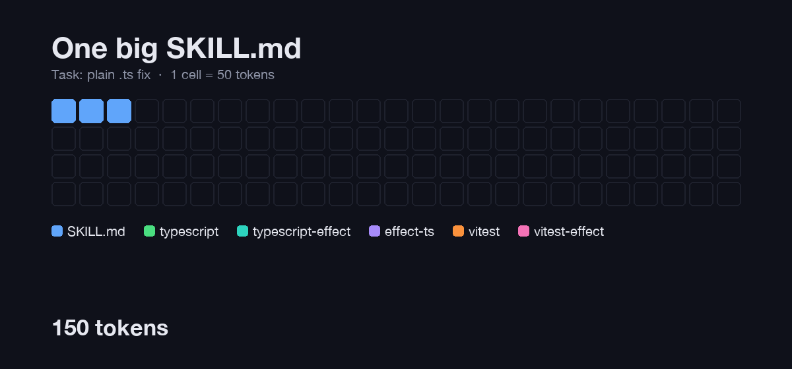

# Chanom

Chanom (ชานม) - Brew a Vite + React app, or add lint, format, commit hooks, and CI to the one you have, in a couple of prompts

## Why I created this?

I created this repository to share my frontend development setup, so others can start a project with the same linting, formatting, commit hooks, and CI without wiring it up by hand. I chose the name "Chanom" because I love milk tea (Chanom) and it would be fitting to think of it as a base milk tea with additional toppings, similar to how you might add additional settings to a React app when creating it.

## Quick start

```sh
# 1. Use the Node version pinned in .nvmrc
nvm use        # or: fnm use

pnpm install

# 3. Verify everything works
pnpm exec turbo run build lint format:check
```

## What is in this repo?

| Package                                             | Description                                                         | README                                             |
| --------------------------------------------------- | ------------------------------------------------------------------- | -------------------------------------------------- |
| [`@chanom/analytics`](./packages/analytics)         | Web analytics facade fanning out to GA, GTM, and PostHog            | [`README`](./packages/analytics/README.md)         |
| [`@chanom/cli`](./packages/cli)                     | Interactive CLI that brews dev tooling config into your project     | [`README`](./packages/cli/README.md)               |
| [`create-chanom-app`](./packages/create-chanom-app) | Scaffold a Vite + React + TS app wired to the chanom shared configs | [`README`](./packages/create-chanom-app/README.md) |
| [`@chanom/dev-config`](./packages/dev-config)       | Shared [oxlint](https://oxc.rs/) + [oxfmt](https://oxc.rs/) presets | [`README`](./packages/dev-config/README.md)        |
| [`@chanom/logger`](./packages/logger)               | Console logger with environment gating and level filtering          | [`README`](./packages/logger/README.md)            |
| [`@chanom/utils`](./packages/utils)                 | Tree-shakable TypeScript utilities for frontend apps                | [`README`](./packages/utils/README.md)             |
| [`@chanom/vite-config`](./packages/vite-config)     | Vite config factory for libraries and React apps                    | [`README`](./packages/vite-config/README.md)       |

## Tech stack

- **Package manager / workspaces:** [pnpm](https://pnpm.io/workspaces) with [catalogs](https://pnpm.io/catalogs) (`catalogMode: strict`)
- **Task runner / cache:** [Turborepo](https://turbo.build/repo)
- **Versioning / publishing:** [Changesets](https://github.com/changesets/changesets)
- **Lint / format:** [oxlint](https://oxc.rs/docs/guide/usage/linter) / [oxfmt](https://oxc.rs/docs/guide/usage/formatter)
- **Build:** [tsdown](https://github.com/rolldown/tsdown), [Vite](https://vitejs.dev/), [TypeScript](https://www.typescriptlang.org/)

## Agent skills: why references are split

The [`coding-standards`](./.claude/skills/coding-standards) skill keeps a short `SKILL.md` that routes the agent to the reference files it needs (`references/typescript.md`, `references/effect-ts.md`, `references/vitest.md`, ...). It is not one large file, because skill text takes up the agent's context window:

- Once loaded, skill text stays in context for the rest of the session and shares space with your code, diffs, and tool output.
- Rules that don't apply to the task are noise. Effect rules sitting in context can leak into plain TypeScript code.
- A plain `.ts` fix loads ~1.4k tokens instead of ~4.3k (68% less). A task that needs every reference costs the same as one large file.



When you add guidance to a skill, put it in the reference file for its topic (or a new one) and add a row to the routing table in `SKILL.md`. Don't grow `SKILL.md` itself.

## Prerequisites

- Node.js `24.18.0` (see [`.nvmrc`](./.nvmrc))
- pnpm `11.9.0` (see [`package.json`](./package.json) `packageManager`)
- (Recommended) VS Code with the recommended extensions in [`.vscode/extensions.json`](./.vscode/extensions.json)
  - `oxc.oxc-vscode` for lint/format
  - `vercel.turbo-vsc` for Turborepo

## Daily scripts

Run these from the repo root:

| Command                            | What it does                                 |
| ---------------------------------- | -------------------------------------------- |
| `pnpm lint`                        | Lint the whole repo with oxlint              |
| `pnpm lint:fix`                    | Lint and auto-fix with oxlint                |
| `pnpm format`                      | Format the whole repo with oxfmt             |
| `pnpm format:check`                | Check formatting without writing files       |
| `pnpm exec turbo run build`        | Build all packages in dependency order       |
| `pnpm exec turbo run lint`         | Run package-level `lint` scripts             |
| `pnpm exec turbo run format:check` | Run package-level `format:check` scripts     |
| `pnpm changeset`                   | Add a new changeset for a public package     |
| `pnpm changeset:version`           | Apply changesets and bump versions/changelog |
| `pnpm changeset:release`           | Build all packages and publish to npm        |

## Create something

### Add a new package

1. Create a directory under `packages/<name>`.
2. Add a `package.json`:
   - `"name"`: `@chanom/<name>`
   - `"version"`: start at `0.0.0` for new packages
   - `"type": "module"`
   - Use catalog versions for third-party deps: `"dep": "catalog:"`
   - Reference workspace packages with `"workspace:*"`
3. Add `README.md`, source files, and a `tsconfig.json` if it is a TypeScript package.
4. Add the usual scripts:
   - `build`, `dev` (when applicable)
   - `lint` / `lint:fix`
   - `format` / `format:check`
5. Run `pnpm install` so pnpm picks up the new workspace member.
6. Build and verify:

   ```sh
   pnpm --filter @chanom/<name> build
   pnpm exec turbo run build lint format:check
   ```

7. If the package will be published, run `pnpm changeset` before opening a PR.

Look at [`packages/vite-config`](./packages/vite-config) for a complete example of a buildable, publishable package.

### Consuming shared configs from outside the monorepo

Packages are published under the `@chanom` scope. See the individual package READMEs for install and usage examples:

- [`@chanom/dev-config`](./packages/dev-config/README.md)
- [`@chanom/vite-config`](./packages/vite-config/README.md)

## Versioning and publishing

This repo uses [Changesets](https://github.com/changesets/changesets).

Typical flow:

1. Make your changes.
2. Run `pnpm changeset` and follow the prompts.
3. Commit the generated changeset file along with your code.
4. After the PR is merged to `main`, run:

   ```sh
   pnpm changeset:version   # bump versions and update changelogs
   pnpm changeset:release   # build all packages and publish
   ```

`baseBranch` is `main` and new packages are published publicly by default (see [`.changeset/config.json`](./.changeset/config.json)).

## Editor setup

The repo ships shared VS Code settings in [`.vscode/settings.json`](./.vscode/settings.json):

- Default formatter: OXC
- Format + fix on save enabled
- Custom words added to the spell checker

## Roadmap

- Roadmap:
  - [x] Vitest preset in `@chanom/vite-config`
  - [x] [`create-chanom-app`](./packages/create-chanom-app) CLI
  - [ ] Shared `tsconfig` preset in `@chanom/dev-config`
  - [x] Analytics package

## Before you commit

- [ ] `pnpm exec turbo run build lint format:check` passes
- [ ] A changeset is added if a public package changed
- [ ] The new package or app has a `README.md`
